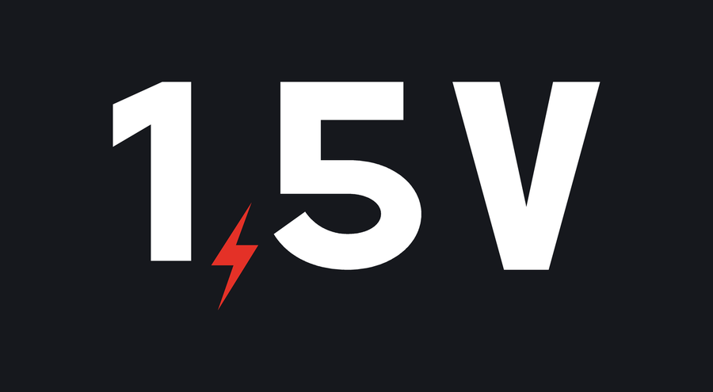

# Sobre

Sou o Arthur, estudante de Engenharia Mecatrônica. Comecei este site para organizar o que estudo e, de quebra, ajudar quem está passando pelas mesmas matérias.

Dois problemas me levaram a fazer isso:

1. **O conteúdo fica espalhado.** Anotação no caderno, PDF no celular, vídeo salvo em alguma playlist. Na hora de revisar, nada está no lugar.
2. **O YouTube esconde os melhores canais de engenharia.** Muitos canais excelentes são pequenos e nunca aparecem no algoritmo. Aqui eles ficam reunidos por assunto.

Este site faz parte do **Volt e Meia** (@voltemeiabr no Instagram e no TikTok).

{ .banner .banner-pequeno }

O nome é um trocadilho: volt e meia é 1,5 V, a tensão de uma pilha comum. E a vírgula do logo virou faísca.

## Aviso

Os resumos são escritos por um estudante e podem ter erros. Sempre confira com a bibliografia da sua disciplina. Achou um erro? Veja [como contribuir](contribuir.md).
